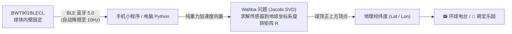

# 环宇寻声 (GlobeSound)：转动地球仪，读出球顶正下方的经纬度

> 实体万向地球仪 + 维特智能 BWT901BLECL 蓝牙姿态传感器 + Python Web / 微信小程序。  
> 转动真实地球仪，自动感知球顶朝向，收听当地电台，或让小萌宠用自然绘本语音给孩子讲世界故事！

---

## 项目亮点

- **百元 DIY 专属物理交互地球仪**：
  - 核心传感器采用维特智能 BWT901BLECL（闲鱼二手约 **¥45**）。
  - 地球仪选用无固定轴的万向地球仪（球座分离式，电商平台约 **¥25–60** 不等）。
  - 总硬件物料成本控制在 **¥80–100** 以内！
- **完美兼容无轴万向地球仪**：
  - 现代万向地球仪底座与球体分离，球体可完全自由三维滚动，不再受传统经纬圈机械轴锁死。
  - 本项目采用**纯重力方向解算**（不依赖地磁，不受马达和金属干扰），传统的 23.5° 地轴倾角在数学模型中与读数无强制相关性，任意地点转到最顶端即可直接读数！
- **双端支持**：
  - **📱 微信小程序版（「环宇寻声」）**：手机直接开蓝牙连接传感器，自动下发 10Hz 降频节能指令，无需电脑中转，走到哪玩到哪。
  - **💻 Python Web 3D 网页版**：三维数字孪生地球仪（`globe.gl`），支持鼠标拖拽互动、真实传感器直连及模拟器巡游。
- **双模式自由切换**：
  - **📻 环球电台模式**：1,648+ 精选网络电台，覆盖全国 34 个省级行政区代表台及全球主要文化都市，带同城切台与曲风分类。
  - **🐼 萌宝环球乐园模式**：专为幼儿启蒙设计，24 个全球宏观生态区大容错 Voronoi 邻近吸附（零盲区、零空转），全套内置**微软 Edge-TTS 神经网络绘本级自然人声**，让孩子听小动物讲当地特色！

---

## 硬件选型与装配清单

### 1. 物料清单 (BOM)

| 物品 | 规格/说明 | 采购渠道与参考价 |
| :--- | :--- | :--- |
| **BWT901BLECL** | BLE 5.0 九轴姿态传感器（本项目仅使用加速度计解算重力） | 闲鱼二手约 **¥45**（全新原装约 ¥120–160） |
| **万向地球仪** | 球体与底座分离式/无固定轴，建议直径 20~25cm | 淘宝/拼多多/1688 约 **¥25–60** 不等 |
| **3M VHB 双面胶 / 热熔胶** | 固定模块和配重 | 约 ¥5–10 |
| **配重块** | 钓鱼铅坠、废旧硬币或垫圈（约 19g，与模块等重） | 约 ¥2–5 |
| **蓝丁胶** | 球体配平微调 | 约 ¥5 |

### 2. 装配要点

模块尺寸为 51.5 × 36.1 × 15mm，重量约 19g。

1. **结构说明**：
   采用球座分离的无轴地球仪，底座通常带 3 个平滑滚珠或凹形托槽，球体可向任意方向 360° 自由旋转。球顶读数点即为球体**几何正上方最高点**。
2. **开检修口**：
   在南极洲区域（南纬 70° 附近，人迹罕至且地图拼缝少）用美工刀切开一个约 55×40mm 的长方形小门，切下的塑料皮保留做盖板。
3. **固定传感器**：
   用 3M VHB 胶把 BWT901BLECL 牢固贴在检修口旁边的内壁上。**Type-C 充电口和电源开关朝向检修口**，方便随时插线充电或开关机。
4. **配平（重心归中）**：
   19g 的模块贴在球壁会导致球体重心偏离球心，松手时球体因偏心自转。
   - 用一根长竹签顶着粘有热熔胶的配重块（约 19g），穿过球心粘在传感器正对面的内壁（即北极附近的内壁）。
   - 把球转到任意角度松手，若有轻微偏转，取少量蓝丁胶在检修口微调，直至球体在底座上**随意放置均静止不溜车**。
5. **合上盖板**：
   用美纹纸或透明胶带合上检修口即可。

---

## 姿态解算与标定原理



1. **纯重力解算，无磁干扰**：
   地球仪静止时，加速度计测得的向量即为绝对物理正上方（$1g$ 重力反方向）。算法完全不依赖磁力计，彻底摆脱室内地磁扭曲、电机以及电脑金属外壳的漂移影响。
2. **四点向导式标定（Wahba 问题）**：
   传感器在球体内的粘贴姿态是任意的。用户仅需根据向导，依次将 4 个已知经纬度地点转到正上方最高点并停稳记录：
   - ① **北极** (90°N, 0°)
   - ② **赤道交点** (0°, 0°)
   - ③ **新加坡** (1.35°N, 103.82°E)
   - ④ **悉尼** (-33.87°S, 151.21°E)
   利用 Jacobi SVD 求解正交旋转矩阵 $R$，标定完成后算法残差（RMS）一般在 1°~2° 以内，数据自动持久化到本地。

---

## 软件运行指引

### 方式 A：微信小程序版（推荐）

微信小程序已全套开源于 [`miniprogram/`](file:///Users/zhangbin/workspace/globesound/miniprogram/) 目录：

1. 打开 **微信开发者工具**，导入目录选择 `miniprogram/`。
2. 开发者工具上方点击 **预览**，使用手机微信扫码进入。
3. 手机开启蓝牙，点击“连接蓝牙”选中 `WT901BLE...` 传感器。
4. 首次使用根据向导完成 4 点标定（耗时约 30 秒）。
5. 自由玩耍：
   - 切换到 **`🐼 萌宝乐园`**：转动地球仪，内置微软 Edge-TTS 绘本普通话语音会自动为孩子讲当地动物故事，点击头像可重复听！
   - 切换到 **`📻 环球电台`**：转到任一国家或省份，自动搜索并播放当地广播电台。

> 详细配置与部署指南请见 [miniprogram/README.md](file:///Users/zhangbin/workspace/globesound/miniprogram/README.md)。

---

### 方式 B：Python Web 版（电脑端）

需要 Python 3.9 或更高版本。

```bash
# 1. 创建并激活虚拟环境
python3 -m venv .venv && source .venv/bin/activate

# 2. 安装基础依赖
pip install -r requirements.txt

# 3. 运行程序（连接真实硬件）
python -m globesound --web

# 4. 无硬件模拟器体验（自动巡游世界主要名城与萌友）
python -m globesound --simulate --web
```

- 浏览器打开 <http://localhost:8765/>。
- 页面顶部支持随时在 **`📻 环球电台`** 与 **`🐼 萌宝乐园`** 之间切换。
- **支持鼠标直接拖拽互动**：在浏览器里用鼠标拖拽旋转 3D 地球仪，松手即会自动吸附并触发朗读！
- 快捷键：萌宝模式下按 **空格键** 重播音效，按 **Enter 键或 T 键** 朗读故事；电台模式下用 **方向键 ◀ ▶** 切换同城电台。

---

## 常见问题与排查 (FAQ)

### 1. 传感器耗电快怎么办？
- 维特智能传感器出厂默认采样率可能高达 50Hz 或 100Hz，蓝牙连续广播耗电很大。
- 本项目小程序已内置**自动降频机制**：连接建立后会自动下发 `FF AA 03 06 00` 将回传率调节至 10Hz，可让 200mAh 电池续航延长至 15~20 小时。
- 长时间不玩时请拨动检修口内的物理开关关机。

### 2. 球体停不住，总会慢慢自己转动？
- 说明配平存在轻微偏差。将传感器正对面的配重块调整到与传感器等重（约 19g），并在检修口处用少量蓝丁胶粘贴在偏轻的一侧做微调，直到球体在任意角度均能平稳静止。

### 3. 20cm 地球仪人工转动误差大，找不准小国家怎么办？
- 直径 20cm 的地球仪周长仅约 62.8cm，手转误差普遍在 $3^\circ \sim 5^\circ$。
- **萌宝乐园**采用全球 24 个宏观生态区 Voronoi 邻近吸附体系，半径覆盖 $12^\circ \sim 45^\circ$，陆地海洋 100% 全覆盖，绝对不会出现轮空转或死区。
- **电台模式**采用三级阶梯缓冲区（0.5° 同城 → 3° 邻近 → 8° 广域兜底），并配置了各大洋海事短波台兜底。

---

## 项目结构

```
globesound/
├── globesound/                     # Python 核心服务
│   ├── cli.py                      # 命令行与蓝牙服务
│   ├── geo.py                      # 纯重力 SVD Wahba 解算核心
│   ├── sim.py                      # 虚拟地球仪模拟器
│   ├── web.py                      # 轻量 HTTP / SSE 流服务
│   ├── stations.py                 # 网络电台检索与缓存
│   └── static/                     # Web 3D 前端 (index.html, kids_zones.json, audio/)
├── miniprogram/                    # 完整微信小程序源码
│   ├── app.js / app.json           # 小程序全局配置
│   ├── audio/kids/                 # 24 个生态大区 Edge-TTS 高品质离线语音
│   ├── data/kids_zones.json        # 24 大萌宝生态区配置
│   ├── data/stations.json          # 1,648 座精选全球网络电台
│   ├── pages/index/                # 主页（电台/萌宝乐园双模式）
│   ├── pages/calibrate/            # 四点向导式标定页
│   └── utils/                      # BLE 驱动、SVD 解算、音频发生器
└── scripts/
    ├── build_kids_audio.py         # 基于 edge-tts 批量生成自然语音的构建脚本
    └── build_enhanced_stations.py  # 电台全量抓取与清洗工具
```

---

## 开源协议

MIT License
