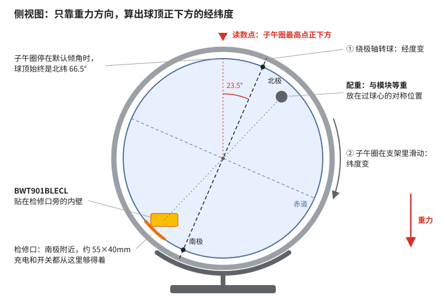

# globesound：转动地球仪，读出球顶正下方的经纬度

硬件：维特智能 BWT901BLECL（蓝牙 5.0 九轴姿态传感器，已购）+ 一台万向地球仪（地轴默认倾斜约 23.5°）。

## 结论

把 BWT901BLECL 固定在球体内壁，**读数点定为"子午圈最高点正下方"**。球静止时，只用加速度计测到的重力方向，就能算出这个点的经纬度。不用磁力计，读数不会漂，地轴的 23.5° 倾角、底座转不转，都不影响计算。用 4 个已知地点标定一次之后，转到哪里，电脑就输出哪里的坐标。

有三件事必须先知道：

1. **纬度要靠滑动子午圈来调。** 子午圈停在默认的 23.5° 时，只转球的话，球顶永远在北纬 66.5° 那一圈上。想读别的纬度，要让子午圈在支架里滑动，万向地球仪一般都能做到。
2. **模块只能装在球里面。** 球和子午圈之间只有几毫米，贴在外面会刮到子午圈。
3. **装进去以后要配平。** 19g 的模块会让球自己转，要在对面加一块等重的配重。

**接下来的顺序：** 到货后先在桌面上跑通软件 → 开检修口、装模块 → 配平 → 标定 → 开始用。

## 原理



- 球静止时，加速度计的读数就是"正上方"在传感器坐标系里的方向。
- 传感器和球之间是一个固定的旋转关系。标定时用 SVD 解 Wahba 问题把它求出来，然后把"正上方"换算到地理坐标系，就得到读数点的经纬度。
- 转球和滑动子午圈，改变的都只是"正上方落在球面的哪个位置"。所以计算里根本不需要知道倾角是多少。


## 装配

模块尺寸 51.5×36.1×15mm，重 19g。

1. **先确认结构**：子午圈能不能在支架里滑动？球径多大？打开后有没有一根轴贯穿球心？
2. **开检修口**：在南极洲、离南极轴销 2–3cm 的地方（大约南纬 70°），切一个约 55×40mm 的口。切下来的那块留着当盖板。
3. **装模块**：用 3M VHB 双面胶或热熔胶，把模块贴在检修口旁边的内壁上，Type-C 口朝着检修口（如果有电源开关，也让它朝着检修口）。一定要粘牢：模块挪动过，就得重新标定。
4. **加配重**：配重要和模块一样重（约 19g），放在模块过球心的对称位置，也就是北极附近的对面。做法是拿一根长竹签，从检修口伸进去，穿过球心顶到对面的内壁，用竹签头把粘了热熔胶的配重（钓鱼铅坠或几枚硬币）按上去。
5. **盖上检修口**：用美纹纸胶带，或者两颗小磁铁固定。用磁铁没关系，因为方案不用磁力计。
6. **配平**：把球转到几个不同的姿态再松手。哪一边往下转，就在它对面加一点蓝丁胶，直到摆在哪里都不动。
7. **加摩擦**（球还是会慢慢转时才需要）：在子午圈和支架接触的地方贴毛毡，在轴销处加橡胶垫圈。

如果打开后发现有一根轴贯穿球心，也可以把模块直接扎在这根轴的正中间。这样天然平衡，不用配重；代价是充电口和开关够不着，要用一根 Type-C 延长线引到检修口。

## 软件

需要 Python 3.9 或更高版本。

```bash
cd /Users/zhangbin/workspace/globesound
python3 -m venv .venv && source .venv/bin/activate
pip install -r requirements.txt
python -m globesound            # 第一次运行会进入标定
python -m globesound --recalibrate
```

- macOS 第一次运行时，要在"系统设置 → 隐私与安全性 → 蓝牙"里允许终端使用蓝牙。
- 程序会自动扫描传感器；认不出来时，会列出附近所有蓝牙设备，用 `--address` 指定即可。
- **标定**：按提示依次把北极、(0°, 0°)、新加坡、悉尼转到子午圈最高点的正下方，每次松手后按回车。程序会给出残差，超过 3° 说明有某个点没放准。
- **输出**：标准输出每次打印一行 `{"lat": 22.5, "lon": 114.1}`，提示信息都打到标准错误，所以可以直接用管道交给别的程序：`python -m globesound | your_app`。
- **网页地球仪**：加 `--web`，浏览器打开 <http://localhost:8765/>，网页里的地球会跟着实物转，读数点始终在画面中心。转动中准星是青色，跟手但精度一般；静止约 1 秒后变成琥珀色，并记一条读数，精度和标准输出一样。拖动网页会暂停跟随，点"回到跟随"恢复。手机要访问的话，再加 `--web-host 0.0.0.0`，用电脑的局域网 IP 打开。
- **模拟器**（不需要硬件）：`python -m globesound --simulate --web`。一台安装姿态随机的虚拟地球仪会按固定路线巡游几个城市，数据包走的是和真机一样的解析、静止判断、标定流程，不会读写 `globe_calib.json`。
- **测试**（不需要硬件）：`pip install -r requirements-dev.txt && python -m pytest -q`。

## 精度

- 传感器标称倾角精度 0.2°。
- 仿真结果：传感器噪声为 0.2° 时，标定后球面任意一点的最大误差约 0.7°（见 `tests/test_geo.py`）。
- 实际使用还要加上标定和读数时用眼睛对位的误差，估计整体在 1° 左右，相当于地面上约 110km。子午圈本身挡在读数点上方，对位时从侧面看。

## 材料清单

| 物品 | 用途 | 参考价 |
| --- | --- | --- |
| BWT901BLECL | 测重力方向 | 已购 |
| 万向地球仪 | 本体 | 已有 |
| 3M VHB 双面胶或热熔胶 | 固定模块和配重 | ¥10–20（估） |
| 钓鱼铅坠或硬币 | 配重，凑约 19g | ¥5（估） |
| 蓝丁胶 | 配平微调 | ¥5（估） |
| 毛毡垫、橡胶垫圈 | 加摩擦 | ¥5–10（估） |
| 美工刀、长竹签 | 开口、送配重 | 家里有 |

## 风险与对策

| 风险 | 表现 | 对策 |
| --- | --- | --- |
| 子午圈不能在支架里滑动 | 只能读北纬 66.5° 那一圈 | 先确认结构；不能滑动的话，要换成编码器方案（见附录） |
| 配平没做好 | 球慢慢自己转，一直不出坐标 | 对面加配重，再用蓝丁胶微调；最后加毛毡增加摩擦 |
| 续航只有 4–6 小时 | 用着用着断开连接 | 通过检修口充电；不用时关机 |
| 模块没粘牢 | 读数慢慢变偏 | 用 VHB 或热熔胶粘牢；动过就加 `--recalibrate` 重新标定 |
| 标定点没放准 | 残差超过 3° | 重新标定；对位时从侧面看子午圈的边 |

## 下一步

- [ ] 到货后充电，在桌面上跑 `python -m globesound`，确认能连上、有数据
- [ ] 确认地球仪的结构（子午圈能否滑动、球径、轴是否贯穿），拍照放进 `docs/`
- [ ] 开口、装模块、加配重、配平
- [ ] 标定，残差要在 3° 以内
- [ ] 决定坐标拿来做什么（项目叫 globesound，比如按坐标播放当地的声音或电台，还没定）

背景资料、其他方案和参考链接见附录：[docs/research-notes.md](docs/research-notes.md)。
